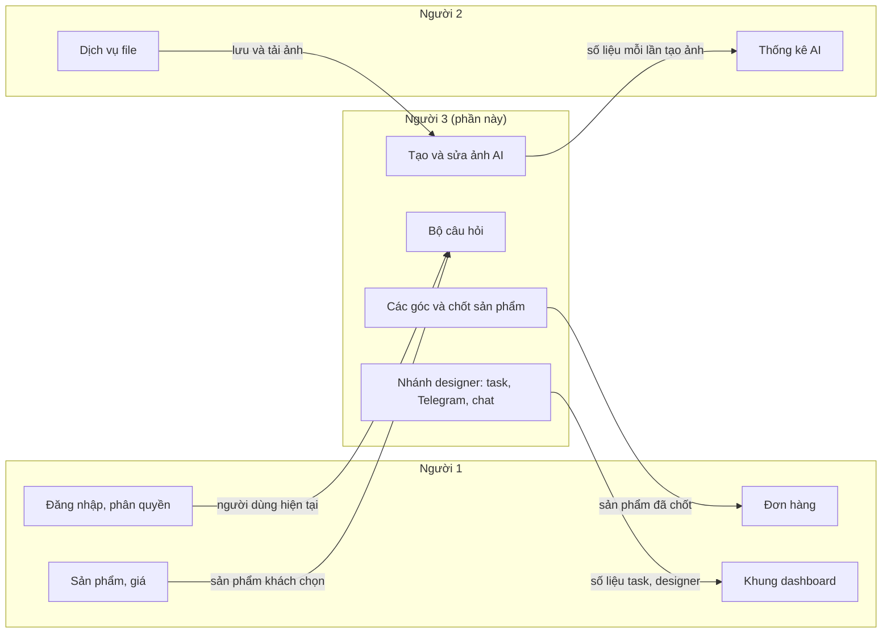
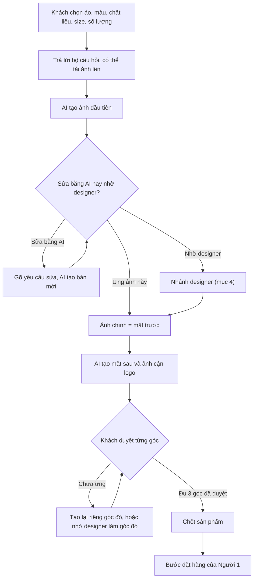
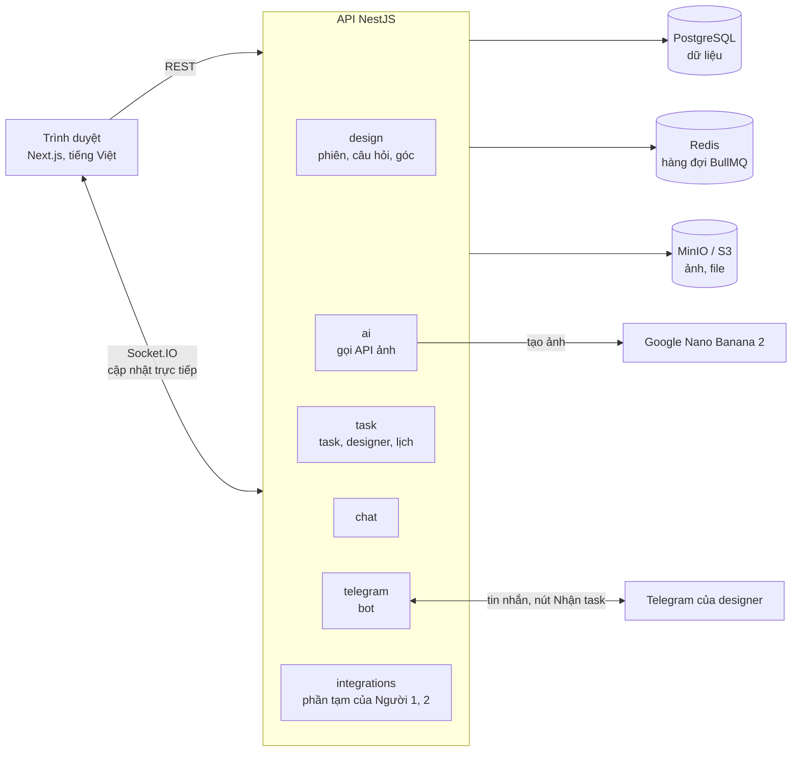
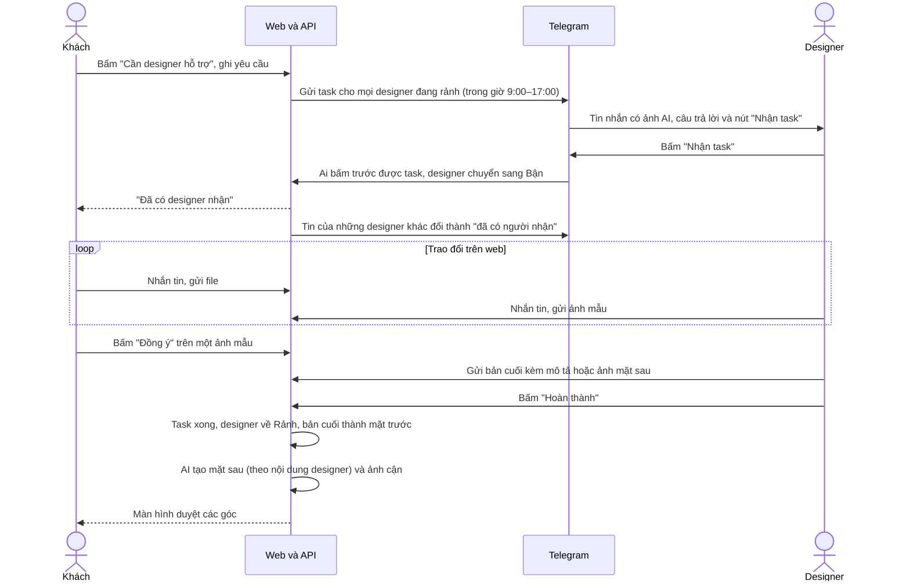
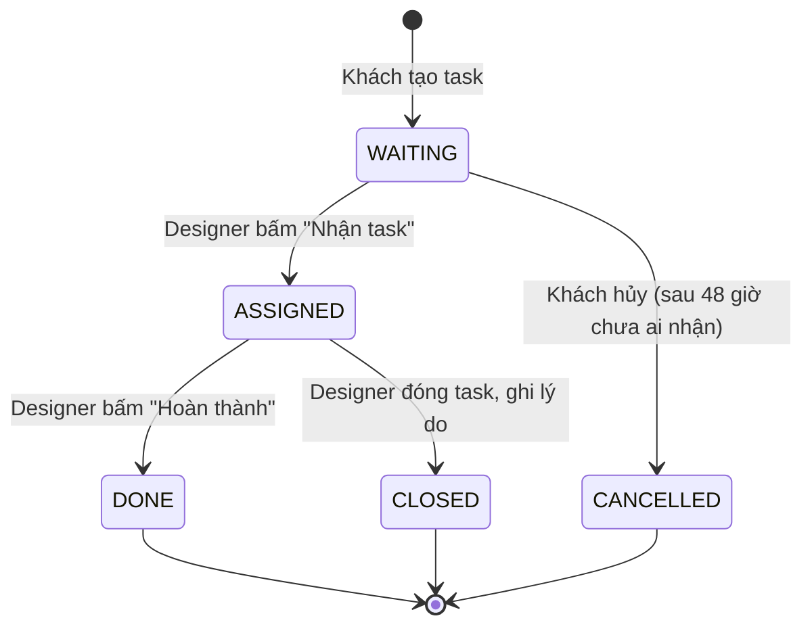
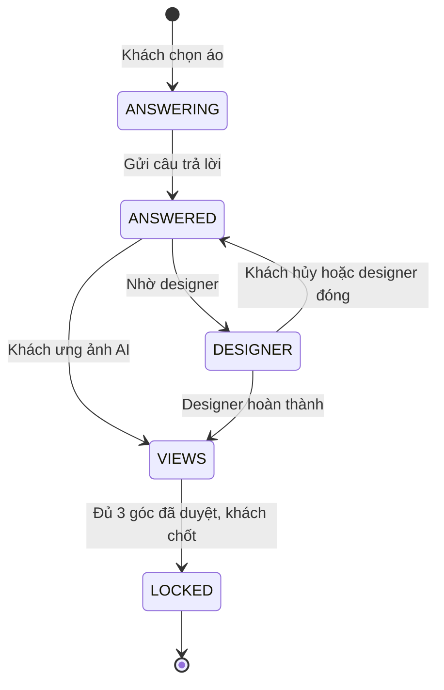
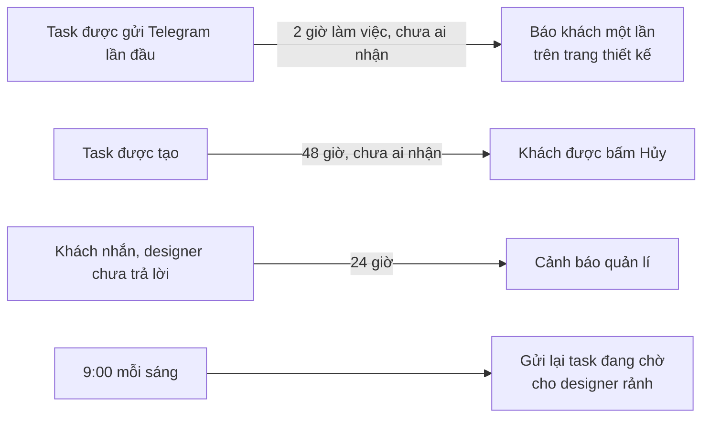
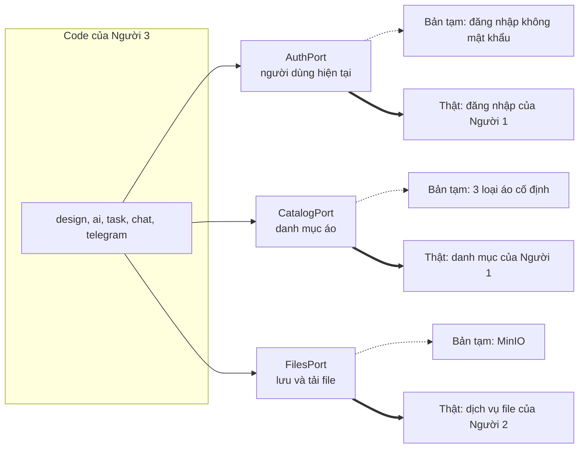
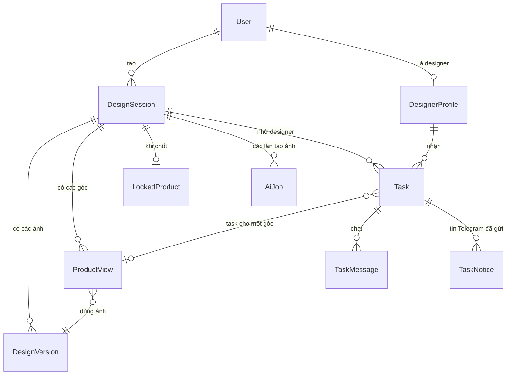

# Phần AI và nhánh designer: giải thích bằng sơ đồ

> Viết ngày 2026-11-10 cho cả nhóm. Mã nguồn: https://github.com/duytienitptit/graduation-thesis
> Các sơ đồ dùng Mermaid, GitHub tự vẽ khi mở file này. Bản kỹ thuật đầy đủ (API, interface, quy tắc) ở [03-team-integration.md](03-team-integration.md).

## 1. Ai làm phần nào

Hệ thống là website đặt áo in theo thiết kế riêng, không thanh toán online: quản lí gọi điện xác nhận từng đơn. Ba người chia việc như sau:

Phần của Người 3 nằm giữa: nhận sản phẩm khách chọn từ Người 1, dùng dịch vụ file của Người 2, và trả về một **sản phẩm đã chốt** cho bước đặt hàng của Người 1.

## 2. Khách đi qua những bước nào

Giải thích:
- **Bộ câu hỏi** hỏi trước những gì ảnh hưởng đến hình (phong cách, màu, chữ, logo...), để khách không phải tạo nhiều ảnh mới ra đúng ý.
- Khách **phải có ít nhất một ảnh AI** rồi mới nhờ designer được. Từ ảnh thứ hai, mỗi lần sửa đều có hai nút: "Sửa bằng AI" và "Cần designer hỗ trợ".
- Mỗi sản phẩm **bắt buộc có 3 góc**: mặt trước, mặt sau, ảnh cận logo (áo không có logo thì cận hình in). Khách có thể thêm tối đa 2 góc nữa.
- Giới hạn **20 ảnh mỗi ngày mỗi tài khoản**, tính lại lúc 0:00 giờ Việt Nam. Ảnh tạo lỗi không bị tính.

## 3. Hệ thống gồm những gì

Giải thích:
- **Hàng đợi (BullMQ trên Redis):** tạo ảnh mất khoảng 10 giây và có thể lỗi, nên mỗi yêu cầu vào hàng đợi, có worker xử lý và tự thử lại. Tin Telegram cũng đi qua hàng đợi để Telegram chậm không làm treo web.
- **Socket.IO:** khi ảnh xong, có tin nhắn mới hay task đổi trạng thái, trang của khách và designer tự cập nhật, không cần tải lại.
- **Telegram** chỉ dùng để báo task mới và để designer bấm "Nhận task". Chat với khách diễn ra trên web.
- **API ảnh chỉ được gọi từ backend**, key không bao giờ lộ ra trình duyệt.

## 4. Nhánh designer từ đầu đến cuối

Giải thích:
- **Không bao giờ có hai designer cùng nhận một task:** việc kiểm tra "task còn trống và designer còn rảnh" và việc giao task chạy trong cùng một thao tác của database.
- Ngoài giờ, khách vẫn tạo được task. Task chờ và được gửi lúc 9:00 sáng hôm sau.
- Hệ thống **không quy định cách designer làm việc**; chỉ cung cấp chat, gửi ảnh mẫu, nút "Đồng ý" cho khách và nút "Hoàn thành" cho designer.
- Nút "Hoàn thành" chỉ bấm được khi khách đã đồng ý một mẫu **và** designer đã gửi bản cuối có nội dung mặt sau. Nếu designer gửi mẫu mới, lần đồng ý cũ mất hiệu lực.

## 5. Trạng thái của một task

| Trạng thái | Nghĩa |
|---|---|
| `WAITING` | Đang tìm designer |
| `ASSIGNED` | Designer đã nhận, đang làm |
| `DONE` | Designer hoàn thành, ảnh đã chuyển sang bước duyệt góc |
| `CLOSED` | Designer đóng sớm, thường vì khách không phản hồi; khách thấy lý do |
| `CANCELLED` | Khách hủy vì quá 48 giờ chưa ai nhận |

Designer chỉ làm **một task một lúc**. Khi task kết thúc bằng `DONE` hoặc `CLOSED`, designer về Rảnh ngay trong cùng thao tác, nên không bao giờ bị kẹt ở Bận. Designer vừa rảnh sẽ nhận luôn các task đang chờ.

## 6. Trạng thái của một phiên thiết kế

- `ANSWERED` là lúc khách sửa ảnh bằng AI.
- Trong lúc chờ hoặc làm với designer (`DESIGNER`), khách không sửa bằng AI được, để không có hai hướng chạy song song.
- Nhờ designer làm lại **một góc** ở bước `VIEWS` không đổi trạng thái phiên: các góc khác vẫn duyệt được, chỉ chưa chốt được cho đến khi designer xong góc đó.
- Sau khi chốt (`LOCKED`), ảnh không sửa được nữa. Muốn đổi thì bắt đầu phiên mới.

## 7. Các mốc thời gian tự động

Một việc kiểm tra chạy **mỗi 10 phút**, nên thông báo có thể trễ tối đa khoảng 10 phút.

- **2 giờ làm việc** chỉ tính trong khung 9:00–17:00. Ví dụ gửi lúc 16:00 thì đến 10:00 sáng hôm sau mới đủ 2 giờ.
- **24 giờ im lặng** chỉ tính khi đến lượt designer trả lời: từ lúc nhận task nếu designer chưa nhắn gì, hoặc từ tin nhắn (hay lần "Đồng ý") cũ nhất của khách mà designer chưa đáp. Designer nhắn lại thì cảnh báo được xóa.
- **Màn hình quản lí** để xem cảnh báo và trả task về hàng đợi thuộc phase 9, chưa làm.

## 8. Chỗ ghép với Người 1 và Người 2

Phần của hai bạn hiện là **bản tạm**, nằm sau các "cổng" (interface) nhỏ. Khi ghép, mỗi người cắm phần thật vào đúng cổng đó; phần còn lại của code không phải sửa.

Đường nét đứt là hiện tại, đường đậm là sau khi ghép. Mỗi cổng cần gì:

| Cổng | Của ai | Cần cung cấp |
|---|---|---|
| `AuthPort` | Người 1 | Từ token trả về người dùng: id, email, tên, vai trò (khách hàng, designer, quản lí) |
| `CatalogPort` | Người 1 | Danh sách áo và một áo theo id, **có trường `shirtType`** để chọn bộ câu hỏi |
| `FilesPort` | Người 2 | Tải lên, kiểm tra file sau khi tải, link tải có hạn, và 4 hàm mới cần thống nhất (xem 03, mục 4.3) |

Ngoài ba cổng, còn hai chỗ trao dữ liệu:
- **Sản phẩm đã chốt → Người 1:** một định dạng chung cho cả nhánh AI và nhánh designer: ảnh các góc, câu trả lời và ảnh khách tải lên. Câu trả lời giữ chữ, số và logo gốc chính xác, vì ảnh chỉ để minh họa chứ không phải file in.
- **Số liệu tạo ảnh → Người 2:** mỗi lần gọi API ảnh đã được lưu (loại, kết quả, lỗi, chi phí, thời gian). API trả số liệu này sẽ làm ở phase 9.

## 9. Dữ liệu chính

| Bảng | Lưu gì |
|---|---|
| `DesignSession` | Một lần thiết kế: áo đã chọn, câu trả lời, trạng thái |
| `DesignVersion` | Một ảnh: do AI hay designer làm, ảnh gốc của nó |
| `AiJob` | Một lần gọi API ảnh: kết quả, lỗi, chi phí, thời gian |
| `ProductView` | Một góc của sản phẩm: loại góc, ảnh đang dùng, đã duyệt chưa |
| `LockedProduct` | Sản phẩm đã chốt |
| `DesignerProfile` | Designer: Rảnh, Bận hoặc Tạm dừng, tài khoản Telegram |
| `Task` | Một lần nhờ designer: yêu cầu, trạng thái, mẫu đã đồng ý, bản cuối, nội dung mặt sau |
| `TaskMessage` | Một tin nhắn: chữ, file, ảnh mẫu hoặc bản cuối |
| `TaskNotice` | Tin Telegram đã gửi, để sửa thành "đã có người nhận" hoặc "đã hủy" |

`User` và `FileObject` là bảng tạm, sẽ thay bằng bảng thật của Người 1 và Người 2.

## 10. Còn cần nhóm quyết

1. Các hàm mới của dịch vụ file, và cho phép PDF trong chat (Người 2).
2. Định dạng số liệu thống kê AI (Người 2).
3. Định dạng sản phẩm đã chốt, và bên nào gọi bên nào ở bước đặt hàng (Người 1).
4. Danh mục thật có trường `shirtType` (Người 1).
5. Định dạng số liệu task và designer cho dashboard (Người 1).
6. Ai giữ cổng Socket.IO chung (cả nhóm).
7. Đổi loại áo, màu hoặc chất liệu thì cần phiên thiết kế mới (Người 1).
8. Hạn nộp khóa luận (cả nhóm).
